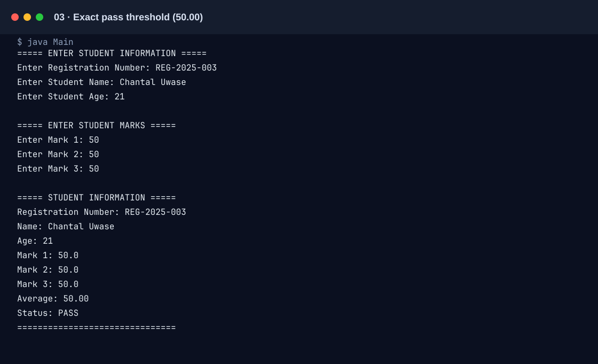

# نظام إدارة الطلاب

برنامج Java بسيط لإدخال بيانات طالب واحد، وحساب متوسط ثلاث علامات، ثم عرض النتيجة الأكاديمية `PASS` أو `FAIL`.

## المتطلبات

- تثبيت JDK يتضمن `javac` و`java`.
- تم التحقق من المشروع باستخدام Temurin OpenJDK 27.0.1.0.2.

## التشغيل

من مجلد المشروع، نفّذ:

```bash
javac Main.java Student.java
java Main
```

أدخل رقم التسجيل والاسم والعمر، ثم أدخل العلامات الثلاث. يقبل البرنامج العلامات من `0` إلى `100`، ويعيد طلب العلامة إذا كانت خارج هذا النطاق. يُعرض المتوسط بمنزلتين عشريتين، ويكون النجاح عند متوسط `50` أو أكثر.

## السيناريوهات التي جُرّبت

| السيناريو | العلامات | المتوسط | النتيجة |
|---|---:|---:|---|
| نجاح اعتيادي | 80، 75، 90 | 81.67 | PASS |
| رسوب | 40، 35، 45 | 40.00 | FAIL |
| حد النجاح | 50، 50، 50 | 50.00 | PASS |
| رفض علامة خارج النطاق ثم إعادة إدخالها | 120 ثم 0، 100، 75 | 58.33 | PASS |

شُغّلت الحالات فعلياً بعد ترجمة الملفين بنجاح. لقطات الطرفية التالية تعرض الإدخالات والمخرجات الناتجة عن كل تشغيل.

## لقطات التشغيل

### نجاح اعتيادي


### رسوب


### علامة النجاح بالضبط



### التحقق من نطاق العلامة


## ملاحظات

- كل تشغيل يعالج طالباً واحداً فقط.
- يتحقق البرنامج من نطاق العلامات، لكنه لا يتحقق من العمر أو من أن الإدخال رقمي؛ لذلك قد يتوقف عند إدخال نص بدلاً من رقم للعمر أو العلامة.
