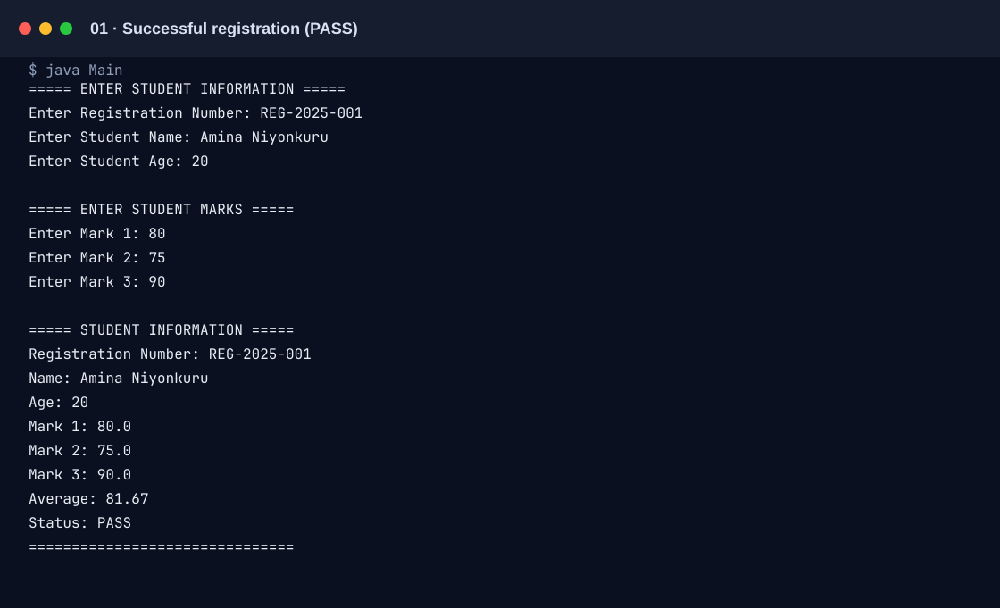
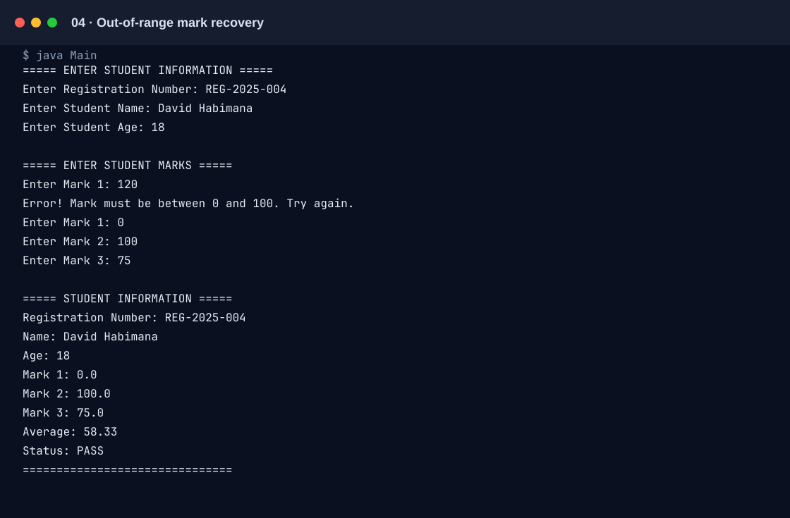

# Student Management System

A simple Java console application that collects one student's details, calculates the average of three marks, and displays an academic result: `PASS` or `FAIL`.

## Requirements

- A JDK installation that includes `javac` and `java`.
- Verified with Temurin OpenJDK 27.0.1.0.2.

## Run the program

From the project directory, compile both source files and start the application:

```bash
javac Main.java Student.java
java Main
```

Enter the registration number, name, age, and three marks. Marks must be between `0` and `100`, inclusive. An out-of-range mark is rejected and requested again. The program displays the average to two decimal places and reports `PASS` when the average is at least `50`.

## Scenarios tested

| Scenario | Marks | Average | Result |
|---|---:|---:|---|
| Typical pass | 80, 75, 90 | 81.67 | PASS |
| Fail | 40, 35, 45 | 40.00 | FAIL |
| Exact pass threshold | 50, 50, 50 | 50.00 | PASS |
| Reject an out-of-range mark, then re-enter | 120, then 0, 100, 75 | 58.33 | PASS |

All scenarios were run after compiling the source files successfully. The screenshots below show the inputs and console output from each run.

## Screenshots

### Typical pass



### Fail


### Exact pass threshold


### Mark range validation



## Notes

- Each program run handles one student.
- Marks are checked against the `0` to `100` range. Age is not validated, and non-numeric input for age or marks can stop the program.
